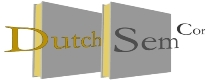

# DutchSemCor Project Homepage

## Project Goal
The goal of DutchSemCor was to deliver a one-million word Dutch corpus that is fully sense-tagged with senses and domain tags from the Cornetto database (STEVIN project STE05039). 250K words of this corpus were manually tagged. The remainder was automatically tagged using three different word-sense-disambiguation systems (WSD), and was validated by human annotators. The corpus data is based on existing corpus material collected in the projects CGN, D-CoI and SoNaR. The corpora were extended where necessary to find sufficient examples for meanings of words that are less frequent and do not appear in the above corpora. The resulting corpus, for which we aimed to offer the same balance in types of text as these basic resources, is extremely rich in terms of lexical semantic information. Its availability enables many new lines of research and technology developments for the Dutch language.

The project DutchSemCor was funded by the NWO and carried out by a consortium of three universities:
Language and Communication, Faculty of Arts, VU University Amsterdam
Tilburg centre for Creative Computing, Faculty of Arts, University of Tilburg
ISLA, Faculty of Science, University of Amsterdam

Below are some examples of how to cite the papers we have published:
– Vossen P., Görög, A., Izquierdo, R. (2012). DutchSemCor: targeting the ideal sense-tagged corpus. In: Proceedings of the Eighth conference on International Language Resources and Evaluation (LREC’12), Istanbul, Turkey.
– Vossen P., Görög, A., Laan, F., Van Gompel, M., Izquierdo, R. , Van den Bosch, A. (2011). DutchSemCor: building a semantically annotated corpus for Dutch. In: Proceedings of Electronic Lexicography in the 21st century: New Applications for new users (eLEX2011), Bled, Slovenia, November 10-12, 2011

For more information, please read the project proposal or contact Prof. Dr. P. Vossen.

Content:
- [Annotated data](dutchsemcor/data/annotated_data.md)
- [Derived data](dutchsemcor/data/derived_data.md)
- [Evaluation desults](dutchsemcor/data/evaluation.md)
- [Software](dutchsemcor/software_tools.md)
- [Publications](dutchsemcor/docs)
- [Workshop](workshop)
- [Team](dutchsemcor/team.md)

